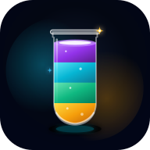
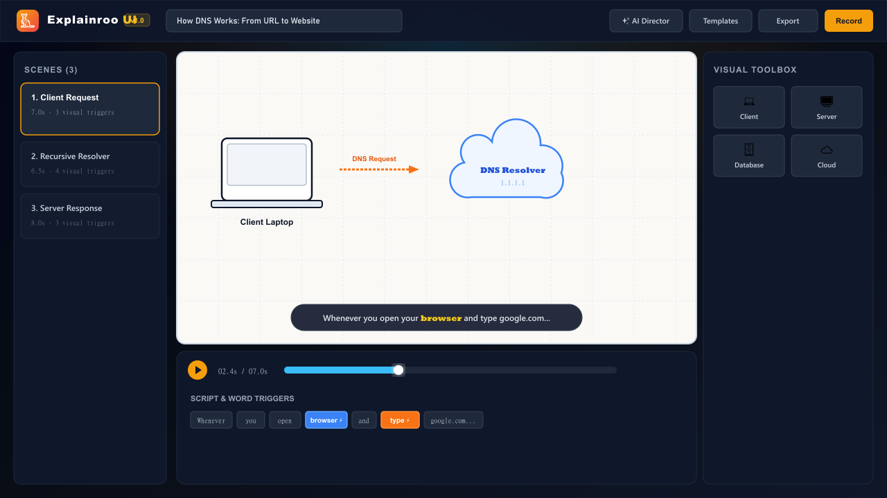
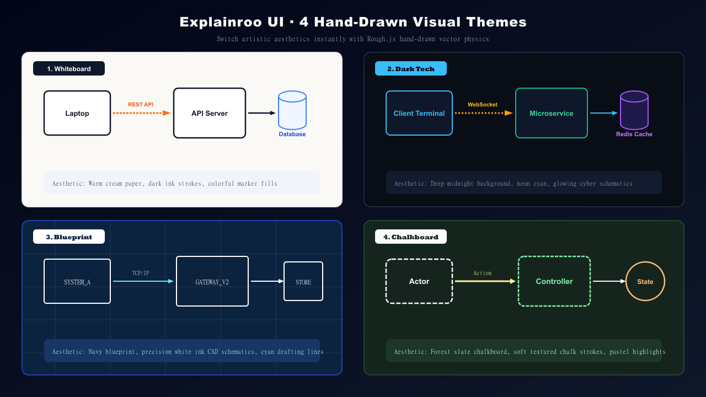
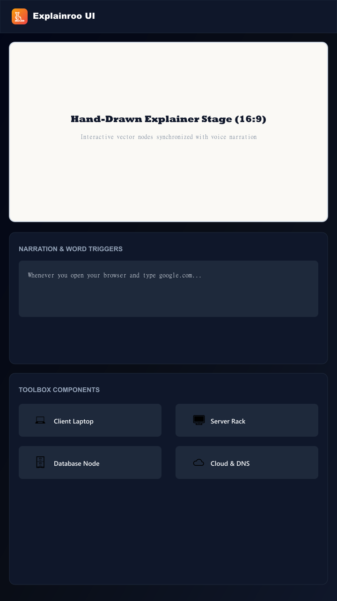

<div align="center">
 
  

  <h1>Explainroo UI</h1>

  <p><strong>Visual No-Code Web Studio for Animated Technical Explainer Videos</strong></p>

  <p align="center">
    <a href="#-direct-download--1-click-run">Direct Download</a> •
    <a href="#-quickstart">Quickstart</a> •
    <a href="#-how-it-works">How It Works</a> •
    <a href="#-4-visual-themes">Themes</a> •
    <a href="#-component-library">Components</a> •
    <a href="#-export--download-formats">Exports</a> •
    <a href="#-sponsor">Sponsor</a> •
    <a href="#-roadmap">Roadmap</a>
  </p>

  <p align="center">
    <sub>Web • React 19 • TypeScript 5.8 • Rough.js • Node.js 18+</sub>
  </p>

  <p align="center">
    Built as an open-source visual web studio for the <a href="https://github.com/vincentsch/explainroo">Explainroo</a> programmatic video engine.
  </p>

  <p align="center">
    
    
    
    
    
    
  </p>

  <p align="center">
    <a href="https://github.com/jastfan/explainroo-ui/archive/refs/heads/main.zip">
      
    </a>
  </p>

  <p align="center">
    <sub>Sponsored with ❤️ by <a href="https://fondpeace.com" target="_blank"><strong>FondPeace.com</strong></a></sub>
  </p>

</div>

---

<div align="center">
  
</div>

---

> **Turn system architectures, developer workflows, distributed systems, and code algorithms into narrated, animated explainer videos** — with hand-drawn Rough.js vector physics, real-time audio ducking, word-synchronized triggers, and 1-click video recording.

---

## 📥 Direct Download & 1-Click Run

You don't need Git or complex command lines to download and run Explainroo UI:

| Platform / Method | Direct Download Link | How to Run |
| :--- | :--- | :--- |
| **Windows** | [📥 **Download Studio ZIP**](https://github.com/jastfan/explainroo-ui/archive/refs/heads/main.zip) | Unzip ➔ Double-click **`start.bat`** *(auto-installs & opens browser)* |
| **macOS / Linux** | [📥 **Download Studio ZIP**](https://github.com/jastfan/explainroo-ui/archive/refs/heads/main.zip) | Unzip ➔ Run **`./start.sh`** |
| **Developer Git** | `git clone https://github.com/jastfan/explainroo-ui.git` | `cd explainroo-ui && npm install && npm run dev` |
| **Standalone Web Player** | Inside Studio ➔ Click **Download / Export** ➔ **Standalone Player** | Downloads a zero-dependency **`.html`** that plays offline anywhere |

### ⚡ 3-Step Instant Launch for Anyone:
1. **Download**: Click [📥 **Download Latest ZIP**](https://github.com/jastfan/explainroo-ui/archive/refs/heads/main.zip).
2. **Extract**: Right-click the downloaded `.zip` and choose **Extract All**.
3. **Run**:
   - On **Windows**: Double-click **`start.bat`**.
   - On **macOS / Linux**: Open Terminal and run **`./start.sh`**.
   - *Explainroo UI auto-installs dependencies and opens your browser at `http://localhost:3000` automatically!*

---

## ⚡ How It Works

Explainroo UI coordinates narration text, speech audio, and vector animations into a synchronized 16:9 canvas:

```
[ Narration Script ] ──> Word Timing Alignment Engine ──> Spoken Timestamp Triggers
                                                                 │
[ Visual Toolbox ]   ──> Hand-Drawn Architecture Nodes ──────────┼──> 16:9 Video Canvas
                                                                 │           │
[ Audio Engine ]     ──> Web Speech TTS + Generative Ducking ────┘           ▼
                                                                        Export Options:
                                                                        • Direct WebM / MP4
                                                                        • Headless CLI Bundle
                                                                        • PNG Poster Frame
```

### The 3-Step Creation Flow

1. **Write or Prompt Narration**: Paste your voiceover script into the editor, or click **AI Director** to let Google Gemini generate a multi-scene breakdown from any software topic or repo.
2. **Anchor Visuals to Words**: Click any spoken word in your script (e.g. *"browser"*, *"database"*, *"cloud"*) to attach diagram components. The element animates onto the canvas the exact split-second that word is spoken.
3. **1-Click Video Recording**: Preview with synchronized voiceover narration and auto-ducking ambient music. Export directly to **WebM / MP4 video** or download a **CLI project bundle** (`script.md` + `scenes.js`).

---

## 🎨 4 Visual Themes

Switch the entire video's artistic personality with a single click. Every theme renders with custom pencil, marker, and hatch-fill strokes:

<div align="center">
  
</div>

- 📝 **Whiteboard** — Warm cream paper (`#faf9f5`), slate ink strokes, and textured colored fills. Ideal for system design and architecture tutorials.
- ⚡ **Dark Tech** — Deep midnight canvas (`#090d16`) with glowing neon cyan cyber schematics. Built for cloud architecture and microservices.
- 📐 **Blueprint** — Navy engineering blueprint (`#0c2340`) with crisp white drafting lines and grid measurements. Perfect for low-level protocols and compiler internals.
- 🎓 **Chalkboard** — Classroom slate (`#15251d`) with soft textured chalk strokes and pastel highlights. Great for computer science algorithms and math.

---

## 📱 Mobile & PWA Experience

Explainroo UI is an installable Progressive Web App (PWA) with responsive touch controls and offline precaching:

<div align="center">
  
</div>

---

## 🚀 Key Features

- **🎨 Hand-Drawn Vector Aesthetics**: Powered by Rough.js with natural pencil wobbles, marker strokes, and cross-hatch fill physics.
- **⚡ Word-Level Synchronization**: Tie any visual element (server, database, terminal, arrow) to a specific word. It pops into view at that exact millisecond.
- **🎙️ Web Audio Narration Engine**: In-browser speech synthesis with customizable speech rate, pitch, and voice selection.
- **📁 Custom Voiceover Audio Import**: Upload external `.mp3` or `.wav` voiceover tracks per scene with live playback preview and instant audio ducking.
- **🎵 Auto-Ducking Background Music**: Generative ambient harmonic chords that dynamically lower volume whenever the narrator speaks.
- **💬 Whisper-Style Dynamic Captions**: Sleek floating subtitle pill that highlights the active spoken word in glowing yellow without obscuring the canvas.
- **🤖 Built-in AI Director**: Generate complete multi-scene explainer video projects from any prompt or repository using Google Gemini.
- **💾 One-Click Video Recording**: Record and download `.webm` or `.mp4` video directly in your browser with zero external dependencies.

---

## 🧰 Component Library

Place pre-built, responsive diagram blocks onto the canvas with a single click:

- **Architecture Nodes**: Client Laptop, Server Rack, Database, Cloud / DNS Cluster, API Gateway, Message Queue.
- **UI Mockups**: macOS Browser Window with live URL bar, Unix Terminal Window with active prompt, Mobile Smartphone viewport.
- **Infrastructure Icons**: Redis Cache (`⚡`), Auth Bearer Token (`🔑`), Edge CDN (`🌐`), End User Actor (`👤`).
- **Dynamic Connectors**: Hand-drawn straight and curved animated arrows with request/response labels.

---

## 📦 Export & Download Formats

- 🌐 **Standalone Offline HTML Player (.html)**: 1-click single-file download with all scenes, vector animations, Whisper subtitles, and voice synthesis embedded. Zero-dependency, offline-ready, double-click to play anywhere.
- 🎬 **WebM / MP4 Video**: Direct client-side video capture ready for YouTube, Twitter/X, LinkedIn, and product demos.
- 📦 **Headless CLI Bundle (.zip)**: Complete package containing `standalone-player.html`, `project.explainroo.json`, `script.md`, and `scenes.js` compatible with `node bin/explainroo.js render`.
- 💾 **Project Backup (.json)**: Save and reload full project state into Explainroo UI anytime.
- 📸 **PNG Frame Poster**: High-resolution 1280x720 canvas snapshot for documentation, thumbnails, and blog posts.

---

## ⌨️ Studio Shortcuts

| Key | Action |
| :--- | :--- |
| <kbd>Space</kbd> | Toggle video playback (Play / Pause) |
| <kbd>Alt</kbd> + <kbd>→</kbd> | Jump to next scene |
| <kbd>Alt</kbd> + <kbd>←</kbd> | Jump to previous scene |
| <kbd>Esc</kbd> | Close active modal |

---

## 🛠️ Quickstart

### Prerequisites
- Node.js 18+ or 20+
- npm or bun

### 1. Clone & Install
```bash
git clone https://github.com/jastfan/explainroo-ui.git
cd explainroo-ui
npm install
```

### 2. Configure Environment (Optional for Gemini AI)
```bash
cp .env.example .env
```
Add your Gemini API key in `.env`:
```env
GEMINI_API_KEY=your_gemini_api_key
PORT=3000
```

### 3. Launch Development Studio
```bash
npm run dev
```

Open **`http://localhost:3000`** in your browser.

---

## 🗺️ Roadmap

- [ ] **Multi-Track Drag & Drop Timeline**: Draggable element cues with magnetic snapping to spoken word markers.
- [ ] **Neural TTS Voiceover**: Integration with ElevenLabs and Edge Neural voices for ultra-realistic narration.
- [ ] **Cloud Persistence**: User accounts and project sync with Supabase / PostgreSQL.
- [ ] **Hardware-Accelerated WebAssembly Export**: Direct `@ffmpeg/ffmpeg` WASM rendering for 60 FPS deterministic H.264 MP4 export.
- [ ] **Developer Logo Library**: Native rough-sketch logos for Docker, Kubernetes, AWS, React, Python, and PostgreSQL.

---

## 🤝 Contributing

Contributions, bug reports, and suggestions are welcome!

1. Fork the repository on [GitHub](https://github.com/jastfan/explainroo-ui/fork)
2. Create your feature branch (`git checkout -b feature/amazing-feature`)
3. Commit your changes (`git commit -m "feat: add amazing feature"`)
4. Push to the branch (`git push origin feature/amazing-feature`)
5. Open a [Pull Request](https://github.com/jastfan/explainroo-ui/pulls)

---

## 💖 Sponsor

Explainroo UI is proudly supported and sponsored by:

<div align="center">

  <a href="https://fondpeace.com" target="_blank">
    
  </a>

  <p>
    <a href="https://fondpeace.com" target="_blank"><strong>FondPeace.com</strong></a> — Promoting inner peace, mindful wellness, and calm productivity for modern creators and developers.
  </p>

</div>

---

## 📄 License

This project is open-source and licensed under the [MIT License](LICENSE).
